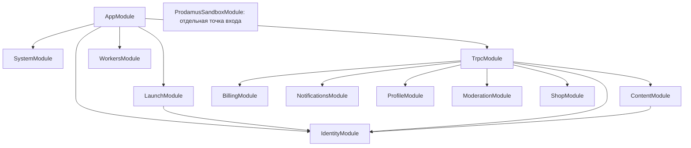

# Backend: карта модулей и открытый аудит — 3 ноября 2026

## Согласованность карточки и вложений — 9 ноября

`post-catalog-repository` и `post-detail-repository`: найдена и исправлена
выдача старой карточки с медиа новой ревизии. Шесть маршрутов проверены через
HTTP/JWT/SQL, чтения объединены в read-only snapshot без изменения DTO.
`feed.listPaginated`, `club.list`, `club.listByCategory`: подтверждены
повторы/пропуски offset между запросами; требуется отдельный контракт курсора.
[Доказательства и приоритеты](backend-post-read-concurrency-2026-11-09.md).

## Завершение процессов API — 6 ноября

Связка `_core/api-shutdown → workers/worker-jobs → database/coordination`
проверена локально на двух OS-процессах и одноразовой MySQL: drain, deadline,
SIGKILL, передача блокировки, откат незавершённой транзакции и HTTP второго API.
Новых дефектов в этих сценариях не выявлено. Потеря только lock-соединения при
живом процессе и авария после внешней отправки этим срезом не закрываются.
[Матрица и приоритеты](backend-worker-shutdown-2026-11-06.md).

## HTTP при перегрузке БД — 6 ноября

Граница `identity/session.controller → DB` и `context/trpc → services → DB`
проверена локально на настоящем насыщенном пуле. Исправлена потеря внутреннего
503; подтверждены сохранность сессии, отсутствие частичной записи поста и
повтор без дубля. Прошли 111 SQL и 132 unit/HTTP-теста. Это не полная приёмка
всех методов, браузера и серверной конфигурации.
[Матрица сценариев и остаток](backend-pool-pressure-http-2026-11-06.md).

## Локальное ревью — 6 ноября

После воспроизведения двух P2 внесены локальные исправления. Статус
`database/connection` и `database/coordination` в границе насыщения — проверено:
очередь ограничена десятью ожиданиями, поздние операции не запускаются,
восстановление пула работает. REST-видео — проверено локально: обрыв отменяет
запрос к S3, повтор восстанавливает один объект. Прошли 147 SQL и 23 unit/HTTP
проверки, типы, линтер, границы, контракт и сборка API. Это не повторная
приёмка всех модулей; серверный бюджет нескольких API остаётся открытым.
[Отчёт, доказательства и приоритеты](backend-code-review-2026-11-06.md).

## UUID в публичных ссылках на посты — 5 ноября

Оба формата ссылки проверены локально. Для гостя, участницы, аккаунта
с истёкшей подпиской и администратора действуют одинаковые правила
доступа при чтении по номеру и UUID. Черновик скрыт в публичном API.
Числовые идентификаторы совместимого API перечислены в
[плане](../../tasks/plan.md#uuid-в-публичных-ссылках-на-посты--5-ноября).

## Обрыв соединения при закрытой загрузке через tRPC — 5 ноября

Закрытые загрузки через tRPC прерывают ожидание S3 при разрыве HTTP.
На тестовом документе подтверждены закрытие соединения, сохранённый
`pending` и восстановление уже принятого файла без второго PUT. Проверка
отмены REST-загрузки видео остаётся отдельным сценарием.
[План](../../tasks/plan.md#обрыв-соединения-при-закрытой-загрузке-через-trpc--5-ноября).

## Права перед записью старого аватара — 5 ноября

Старый `profile.uploadAvatar` перепроверяет состояние после обработки фото.
Смена сессии, блокировка, запрос на удаление и новая версия профиля
отклоняются до вызова хранилища. Если запись файла уже началась, проверка при
привязке защищает профиль, а внешняя запись может завершиться.
[План](../../tasks/plan.md#права-перед-записью-старого-аватара--5-ноября).

## Версия профиля и права на публичную обложку — 5 ноября

Подтверждённые ошибки исправлены локально. Устаревшая версия профиля
отклоняется после привязки аватара. После запроса на удаление аккаунта
старый маршрут обложек отклоняет запись. Оба сценария проверены через
HTTP/JWT и одноразовую MySQL с локальным хранилищем для тестов.
[План](../../tasks/plan.md#версия-профиля-и-права-на-публичную-обложку--5-ноября).

## Права при загрузке публичной обложки — 5 ноября

Старый `admin.uploadPhoto` перепроверяет права между обработкой фото и
публичной записью. Отказы после отзыва сессии, блокировки и смены роли
подтверждены через HTTP/JWT и одноразовую MySQL. Изменение прав после начала
внешней записи остаётся за пределами этого среза.
[План](../../tasks/plan.md#права-при-загрузке-публичной-обложки--5-ноября).

## Сессия при создании заказа магазина — 5 ноября

Создание заказа `shop.createCheckout` проверено через HTTP/JWT и одноразовую
MySQL. Связанный с аккаунтом заказ записывается после повторной проверки сессии
в транзакции. Рабочий сценарий магазина по-прежнему использует заказ по почте.
[План](../../tasks/plan.md#сессия-при-создании-заказа-магазина--5-ноября).

## Сохранение настроек запуска — 5 ноября

`PUT /api/admin/launch-settings` проверен на одноразовой MySQL. Изменение
сессии после входной проверки блокирует запись и аудит внутри транзакции.
[План](../../tasks/plan.md#сохранение-настроек-запуска--5-ноября).

## Очистка имён вложений — 5 ноября

Статус административного `cleanupMediaNames` — проверено на одноразовой MySQL.
Права перепроверяются в транзакции обновления. Проверены отказ для устаревшей
сессии, блокировка, понижение роли, сохранность других полей и откат.
[План](../../tasks/plan.md#очистка-имён-вложений--5-ноября).

Массовый импорт видео также проверен на одноразовой MySQL. Проверка прав
внутри транзакции сохраняет параллельный импорт, откат пачки и пропуск дублей.
[План](../../tasks/plan.md#массовый-импорт-видео--5-ноября).

## Согласие на маркетинговые push — 5 ноября

Статус записи согласия и регистрации устройств при отзыве сессии — проверено.
Гонки воспроизведены через HTTP/JWT и одноразовую MySQL. Оба сценария записи
проверяют состояние аккаунта внутри транзакции. Смена аккаунта на устройстве
проверена до передачи push в Expo: финальная выборка сверяет текущего владельца
токена. REST/tRPC logout отвязывают устройства атомарно с отзывом всех сессий
аккаунта. Проверены rollback и повтор после нового входа. Смена владельца
после финальной выборки и фактическая доставка остаются отдельными сценариями.
Административное удаление push-привязок также проверено: выход, блокировка или
понижение роли до завершения запроса приводят к отказу с сохранением привязок.
[План и остаток](../../tasks/plan.md#согласие-на-маркетинговые-push--5-ноября).

## Продолжение maintenance Pen Pals — 5 ноября

Устранены stale candidate DELETE и решение о деактивации до owner-lock.
Срез проверен 150 SQL и 167 HTTP/unit тестами; правила хранения и API сохранены.
Статус этих переходов — проверены в границах
[отчёта](pen-pal-maintenance-review-2026-11-05.md). Масштабирование списков и
конфигурация production остаются открытыми; весь модуль целиком не принимается.

## Продолжение Pen Pals matches/read — 4 ноября

Request/respond/me/find локально проверяют актуальный actor в транзакции;
выдача адреса использует актуальные связь/активность/блокировку. Ошибки shown
больше не маскируются под успех. 140 SQL и 127 HTTP/unit проходят. Статус этого
среза — проверен; maintenance и масштабирование подбора требуют исследования.
[Доказательства](pen-pal-access-lifecycle-review-2026-11-04.md).

## Продолжение Pen Pals profiles — 4 ноября

Upsert/withdrawal проверяют актуального actor и записывают consent-event в своей
транзакции. Срез проверен 113 SQL и 127 HTTP/unit тестами; maintenance helper
сохранён отдельно от пользовательского withdrawal. Match/read/maintenance аудит
ещё открыт. [Отчёт](pen-pal-profile-lifecycle-review-2026-11-04.md).

## Продолжение profile/identity — 4 ноября

requestAccountDeletion передаёт actor до SQL writer и проверяет его под
блокировкой; дата уже принятой заявки сохраняется. Срез проверен 91 SQL и
89 HTTP/unit тестами, остальной lifecycle Pen Pals ещё требует исследования.
[Отчёт](account-deletion-lifecycle-review-2026-11-04.md). Это локальная проверка,
публичные серверные настройки и весь модуль целиком ею не подтверждаются.

## Проверка безопасности — 4 ноября

Локально исправлены P1 admin/grantClub без ключа и P2 identity/legacy resend, profile/legacy avatar и startup JWT. Общий transaction-time guard используется старыми и keyed admin-действиями. 147 SQL и 200 boundary/unit проверок проходят; зависимости обновлены, production audit — 0. Остальные статусы ниже исторические; полный аудит модулей и среды остаётся открытым.

[Полный отчёт и границы проверки](backend-security-review-2026-11-04.md).

Снимок ДО новых изменений: b44e7998, чистая ветка
feature/stage-one-completion-2026-10-10. Ранее сделанные push/TEST-DI исправления
учтены как история, а не выданы за результат этой карты. Весь аудит **открыт**.

## Последнее продолжение P1–P3

[Срез после2453017a](backend-audit-closure-2026-11-03.md): устранены stale-lease
отправки, оба edge-шаблона проверены с заменой IP API, добавлен безопасный offline
preflight и удалены пять доказанно неиспользуемых helpers. Process-owned pool и
совместимые фасады сохранены как обоснованные границы. Серверная часть P1
остаётся открытой: SSH/HTTPS не дали доступа, выпуск не выполнялся.
Последующая карта содержит249 backend TS-файлов/13 Nest-модулей, runtime SCC нет.
Ниже сохранены исторические снимки и пределы проверки отдельных модулей.

## Последующее состояние

После согласованного продолжения A1/A3/A5/A6 исправлены в ограниченных границах;
A4 реализован и проверен локально для нескольких процессов. A7: владелец
подтвердил прежний best-effort push, очередь не нужна. A8 исследован без
автоматического удаления недостижимых helper exports. Детали, команды и
**открытые P1/P2/P3** в [отчёте продолжения](backend-architecture-followup-2026-11-03.md).

На новом снимке 254 TS-файла, те же 13 Nest-модулей; eager runtime SCC отсутствуют.
Ниже сохранён исходный снимок до исправлений и первоначальные статусы: это
история исследования, а не новые невыполненные задания на уже исправленный код.
Архитектурная и договорная приёмка остаются открытыми.

## Как читать статусы

- **Проверен**: изучены указанные границы и есть приведённое свидетельство;
  это не заявление о проверке каждого внутреннего сценария.
- **Найдены проблемы**: есть конкретный подтверждённый структурный дефект,
  указанный ниже; это не обязательно доказанная пользовательская уязвимость.
- **Требует исследования**: описана структура, но существенная часть поведения
  или интеграции ещё не проверена достаточно глубоко.

Карта покрывает все 13 классов Nest Module, все 16 директорий первого уровня,
10 корневых TS-файлов. Всего 241 исполняемый/обычный TS-файл и одна декларация
_core/types/cookie.d.ts. Из этого числа нельзя выводить процент приёмки.
Вложенные billing/yookassa и content/aesthetic-guides учтены в своих областях.
Фронт, рабочие БД/S3, сервер и настройки не меняются; без push/deploy.

## Граф Nest imports



У остальных Nest-модулей imports пуст. Это **не отсутствие зависимостей**:
обычные TS imports обходят Nest-контейнер и показаны отдельно ниже. Циклов
в данном графе Nest imports не обнаружено. Module exports изучены по исходникам;
новых Global/forwardRef зависимостей в карте нет.

## Все Nest-модули

| Модуль и владелец | Прямые Nest imports | Реальные обязанности/зависимости | Статус и точная граница проверки |
| --- | --- | --- | --- |
| AppModule — app.module.ts | System, Launch, Identity, Trpc, Workers | Сборка приложения; _core/application монтирует security/parsers/tRPC и legacy adapters | Проверен: фабрика, init/listen, ручной старт jobs, native/ESM tests; не живая публикация |
| TrpcModule — _core/trpc.module.ts | Content, Identity, Billing, Notifications, Profile, Moderation, Shop | TrpcService передаёт сервисы в routers.ts; auth/system/PenPals пока статические routers | Найдены проблемы: auth.logout использует собственный SessionService вместо внедрённого экземпляра |
| IdentityModule — identity/identity.module.ts | Нет | REST auth/password/binding; SessionService, guards/filter; db, platform-db, JWT, SMTP, SMS, admin actions | Найдены проблемы: разное владение REST и tRPC session dependency. SQL/HTTP auth проверялись; полный lifecycle binding и все отказы SMTP сейчас не перепроверены |
| ContentModule — content/content.module.ts | Identity | Чтение/запись постов, статей, комментариев, загрузки/защищённая выдача, VK; db/platform-db/media/push | Найдены проблемы: цикл импортов с db/club-access; 91 файл требует дальнейшего анализа транзакций/внешних эффектов, прошлые редакторские тесты не закрывают весь модуль |
| BillingModule — billing/billing.module.ts | Нет | Checkout/subscription/cancellation/settlement, LIVE/TEST Prodamus и YooKassa; db, identity, prodamus facade | Требует исследования: TEST-DI уже исправлен и 155 выбранных SQL/HTTP пройдены ранее; все LIVE/guest-normal/переходы провайдеров этим не проверены |
| ProdamusSandboxModule — billing/prodamus-sandbox.application.ts | Нет | Отдельная диагностическая app, только sandbox controller/service/security; без AppModule/db/workers | Проверен: узкая композиция и существующие runtime/ESM tests; это не платёжная приёмка |
| LaunchModule — launch/launch.module.ts | Identity | Capabilities, настройки оформления/получателя заказов; LaunchService → db/settings | Проверен: revisions/actor recheck/season calculation изучены, прошлые HTTP/SQL и native season cases; live settings не прочитаны заново |
| SystemModule — system/system.module.ts | Нет | REST /api/health, без БД и провайдеров | Проверен: это liveness, не readiness. Отдельный tRPC system.notifyOwner не принадлежит этому Nest-модулю |
| NotificationsModule — notifications/notifications.module.ts | Нет | Token/consent registration, SQL; router rate limiter/capability gate; push transport отдельно | Проверен: границы входа и предыдущие SQL/transport tests. Получение push устройством не подтверждено |
| ProfileModule — profile/profile.module.ts | Нет | Профиль/revision, recovery export, legacy avatar, удаление аккаунта; db/platform-db/content/media | Требует исследования: зафиксированы зависимости и прошлые profile tests; совместные отказы deletion/retention/files требуют отдельного прохода |
| ModerationModule — moderation/moderation.module.ts | Нет | Модерация пользователей/жалоб/комментариев через platform-db и content | Требует исследования: actor/target checks прослежены; полный конкурентный lifecycle модерации и удаления сейчас не выполнялся |
| ShopModule — shop/shop.module.ts | Нет | Старые digital checkout/owned endpoints, capability gate; db/prodamus; действующий магазин формирует mailto во фронте | Требует исследования: backend не доказывает отправку mailto-заказа; receipt/delivery legacy ветки и фактическое письмо менеджеру отдельно |
| WorkersModule — workers/workers.module.ts | Нет | Явный WORKER_OPERATIONS binding: publication, billing/email, retention/shop delivery, backups | Требует исследования: helper functions внедрены явно, это само по себе не дефект. Локальный single-flight не является распределённой координацией; необходимость durable outbox не установлена |

## Фактическая карта областей TS

Стрелка означает прямую зависимость через импорт, а не HTTP-вызов. Здесь перечислены
backend-связи; Node/npm-пакеты и packages/shared/database идут следующим слоем.
Все директории из снимка учтены, включая области без собственного Nest Module.

| Область / число TS-файлов | Прямые соседние области | Статус |
| --- | --- | --- |
| _core / 29 | App, billing, content, db, identity, media, moderation, notifications, prodamus, profile, routers, shop, storage, workers, youtube | Найдены проблемы: pre-Nest session instances, global limiter/config и legacy notification adapter; необязательные helper-интеграции требуют исследования |
| admin / 5 | _core, billing, content, db, identity, media | Требует исследования: нет своего Nest Module; router собирает read/write/admin operations, полный анализ всех транзакций впереди |
| billing / 39 | _core, db, identity, prodamus, sms-auth | Требует исследования: legacy фасады + новые services, внепроцессная платёжная приёмка открыта |
| club / 1 | _core, billing, content, db, media | Проверен: router composition и middleware; это транспорт, не самостоятельный сервис |
| content / 91 | _core, db, identity, media, moderation, platform-db, push | Найдены проблемы: компонент импортного цикла; права и сохранение файлов не считать целиком проверенными |
| database / 1 | Только внешние mysql2/Drizzle | Требует исследования: mysql-utf8 tooling adapter, не основной runtime pool |
| identity / 22 | _core, admin, db, launch, platform-db, sms-auth | Найдены проблемы: session dependency ownership; sensitive lifecycle остаётся в очереди |
| launch / 5 | db, identity | Проверен в указанном выше объёме |
| media / 14 | _core, content, db, storage | Требует исследования: object policies/receipts/MIME/VK fetch; S3 и большие файлы сейчас не проверялись |
| moderation / 4 | _core, content, platform-db | Отзыв прав в dismiss/delete исправлен локально; остальной lifecycle требует исследования, см. [повторный аудит](moderation-revocation-review-2026-11-04.md) |
| notifications / 5 | _core, db, launch, sms-auth | Проверен на транспортной/SQL границе, не доставка устройству |
| pen-pals / 2 | _core, db, launch, platform-db | Требует исследования: прошлые BOLA/lifecycle фиксы не заменяют новый полный проход; функция не включается |
| profile / 5 | _core, content, db, media, platform-db | Требует исследования |
| shop / 3 | _core, db, launch, prodamus | Требует исследования |
| system / 1 | Нет backend-зависимостей | Проверен как liveness |
| workers / 4 | _core, billing, db, identity, platform-db, prodamus, push, shop-delivery | Требует исследования: ограничения координации/гарантий доставки, см. приоритеты |

| Корневой TS-файл | Зависимости и ответственность | Статус |
| --- | --- | --- |
| app.module.ts | Корень Nest, граф выше | Проверен |
| routers.ts | _core/admin/billing/club/content/identity/moderation/notifications/PenPals/profile/shop; legacy appRouter + Nest factory | Найдены проблемы: auth router не принимает session dependency |
| db.ts | _core/admin/billing/content/prodamus; глобальный mysql pool + большой совместимый фасад | Найдены проблемы: цикл с domain helpers, владение pool не на уровне app |
| platform-db.ts | billing/content/db/identity/media/moderation/PenPals | Найдены проблемы: смешаны moderation, consent, retention, PenPals, shop mail, зависимость нескольких доменов |
| prodamus.ts | billing/db/identity/launch/shop-delivery | Требует исследования: контрактные функции, legacy fallback services и Express return adapters вместе |
| push.ts | db + внешний Expo | Проверен для acceptance/ошибок/deadline/cleanup; прошлый срез исправил четыре локальные проблемы, доставки нет |
| shop-delivery.ts | _core/launch/platform-db/push | Требует исследования: отдельный выключаемый digital delivery path, не mailto заказ менеджеру |
| storage.ts | _core/env + AWS SDK | Требует исследования: public/legacy S3 facade; роль и достижимость старых вызовов сверять до удаления |
| sms-auth.ts | _core/db | Требует исследования: отключённый SMS-путь + используемый clientIp helper, целиком удалять нельзя |
| youtube-stream.ts | _core/db | Требует исследования: legacy adapter, наличие файла не означает активный YouTube-каталог |

## Циклы и границы полноты

Локальный AST-анализ строился по TS после удаления type-only imports через
TypeScript transpileModule. Только литеральные static import/export/require
участвуют в поиске eager циклов; dynamic import учитывается отдельно для
достижимости. Это граф исходников до bundler tree shaking, а не доказательство
ошибки инициализации каждой записи. Проверка Nest/общих repo boundaries
не проверяет этот граф feature-зависимостей.

Найдена одна strongly connected component из 12 файлов:

```text
db.ts
identity/club-access.ts
content/article-writes.ts
content/post-attachments.ts
content/post-creator.ts
content/post-editor.ts
content/post-videos.ts
content/private-attachment-association.ts
content/private-attachment-uploads.ts
content/private-comment-actor.ts
content/private-content-binding.ts
content/private-content-uploads.ts
```

Пример пути: db → post-creator → post-attachments → private-attachment-association
→ private-attachment-uploads → db. Проверен по фактическим imports. Сейчас
инициализационный отказ не воспроизведён; риск — порядок загрузки и скрытая
связь SQL-фасада с записью/файлами. Не исправлять весь компонент одним переносом.

18 файлов не достигаются из трёх executable roots в этой модели. Среди них
миграционные/maintenance tools и compatibility context, используемый тестами;
не считать их мёртвым кодом. _core/dataApi, imageGeneration, llm,
voiceTranscription — кандидаты для дальнейшей проверки внешних потребителей,
не разрешение удалить публичные exports.

Локальные артефакты: ../.local-artifacts/backend-module-map-20261103/map.cjs,
map.json и summary.json. Они содержат пофайловые связи и metadata 13 modules,
без env/данных пользователей. Генератор ничего не импортирует на исполнение
и не подключается к БД/провайдерам. Декларация cookie.d.ts просмотрена отдельно.

## Выбор минимального изменения ДО правок

Выбран только **A2: владение SessionService для tRPC logout**, приоритет P2.
REST и tRPC context уже используют внедрённый SessionService, но authRouter
создаёт собственный экземпляр. Сегодня сервис в основном stateless, поэтому
не заявляем о доказанной потере отзыва сессий; подтверждена скрытая зависимость.

Минимальный план: createAuthRouter(session boundary), передать существующий
Nest provider через createAppRouter/TrpcService, сохранить standalone export
и прежний конструктор вызова. Не менять auth policy, SQL, JWT, cookie, DTO,
статусы и frontend. Сначала HTTP-тест двух apps: свой actor, успешный отзыв,
ошибка отзыва без стирания cookie; затем прежние SQL-сценарии logout/replay.

Отдельно выбранные ранее push/TEST-DI исправления уже завершены; повторно
переписывать их ради этой карты не требуется. Цикл/db/platform-db/лимитеры
остаются отдельными следующими задачами, а не частью скрытого большого рефакторинга.

## Оставшиеся архитектурные проблемы и приоритеты

| ID | Приоритет | Подтверждённое / неизвестное | Следующий ограниченный шаг |
| --- | --- | --- | --- |
| A1 | P2 | 12-файловый цикл db/content/club-access подтверждён. Ошибка загрузки не доказана | Отделить конкретный SQL reader/pool boundary без переноса всего db.ts; проверить ESM и транзакционный reader |
| A3 | P2 | Общий pool/db facade и platform-db соединяют много доменов; multi-app lifetime не изолирован | Описать ownership/lifecycle, потом один узкий repository seam; не вводить generic repository |
| A4 | P2; P1 перед второй API-репликой | IntervalJobs координирует только один процесс, rate limiter тоже in-memory. Фактическая topology сейчас не прочитана | Подтвердить число реплик; до горизонтального масштабирования проверить durable claims/общую квоту. Вторую реплику автоматически не включать |
| A5 | P2, требует отдельного воспроизведения | _core/notification.ts выводит body/Error провайдера и не задаёт deadline. Внешний secret leak не проверен | Synthetic fault tests на активном admin endpoint; redaction/timeout при подтверждении, не дублировать большой HTTP framework |
| A6 | P2 | Request-body admission и compatibility context владеют отдельными SessionService; eager import router создаёт legacy services | Отдельно проверить pre-Nest ingress и CLI consumers до изменения composition |
| A7 | P2, условный риск | После публикации push не имеет durable outbox; что именно нужно гарантировать продукту — отдельно | Зафиксировать требуемую доставку. Не добавлять очередь как новую функцию без требования |
| A8 | P3 | Legacy/неиспользуемые helpers, размеры фасадов, форматирование | Проверить runtime/CLI/public consumers и удалять только доказанно неиспользуемое |

Новых подтверждённых P0/P1 дефектов поведения этим структурным проходом не
установлено. Это не означает их отсутствия. Billing LIVE/S3/SMTP/recovery/PenPals,
все транзакционные отказы, нагрузка и удалённая публикация требуют дальнейшей
проверки. Полнота карты не равна полноте аудита.

## Результат выбранного изменения

Карта зафиксирована отдельным коммитом c6b67887 **до** runtime-правок.
Последующее изменение c6a6a051 закрывает только A2 локально:

- createAuthRouter получает существующую session boundary; TrpcService передаёт
  свой Nest provider через createAppRouter. REST/tRPC context/logout теперь
  используют один экземпляр в пределах приложения.
- Standalone authRouter и вызов createAppRouter с прежними аргументами сохранены.
  JWT, SQL, cookie, роли, error/status policy и ответы не менялись.
- Два новых теста сначала получили HTTP500 вместо успешного выхода: запрос
  обходил подставленную app-owned boundary и попадал в старый DB-путь.
  Это контролируемое доказательство обхода DI, **не** утверждение об отказе
  рабочего logout с настоящей БД. После исправления оба теста проходят.
- Проверены две apps со своими actors и отказ одного экземпляра, отсутствие
  Set-Cookie при отказе и отсутствие приватной ошибки в ответе. Вместе с
  прежними native application/session/cookie проверками: 64/64.
- На новом MySQL8.4/tmpfs применены 50 настоящих миграций. С реальными JWT/SQL
  прошли 29/29 tests/nest-sessions.mysql.test.ts: блокировка, отзыв старых
  токенов, повтор выхода, поздний replay и SQL-отказ без ложного успеха.
  Только собственный контейнер удалён, tmpfs уничтожен.

Финальные проверки на Node22.23.2 (PATH=/opt/homebrew/opt/node@22/bin:$PATH):

| Команда | Фактический результат |
| --- | --- |
| pnpm exec vitest run --project unit --maxWorkers=2 | 4010 passed, 94 прежних skipped, 309 passed/28 skipped files, 89,60 с, exit0 |
| pnpm exec vitest run tests/nest-auth-composition.test.ts tests/session-availability.test.ts tests/nest-application.test.ts tests/session-cookie.test.ts | 64 passed, exit0 |
| pnpm db:fresh:local --initialize-empty-local | 50 миграций на отдельной пустой MySQL8.4/tmpfs, pending=[], exit0 |
| pnpm exec vitest run --project mysql tests/nest-sessions.mysql.test.ts | 29 passed, 2,72 с, exit0 |
| pnpm check | root/frontend TypeScript, exit0 |
| pnpm lint:backend | exit0 |
| pnpm build | backend ESM, exit0 |
| pnpm check:api | 107 процедур/46501 байт, контракт прежний, exit0 |
| pnpm check:boundaries | 896 файлов, exit0 |

SQL-команды получили только собственные FRESH_DATABASE_URL/CONTAINER_ID и
BACKEND_TEST_DATABASE_URL на loopback/backend_test; после fresh-профиля
fixture tracker отмечает уже применённые миграции, production history не
меняется. Остальные SQL-наборы в этом срезе не запускались.

В этом продолжении изменены 9 файлов: 3 runtime, 1 новый test и 5 документов,
включая заранее сохранённую карту. Никаких новых пакетов, схем, маршрутов,
фронтовых изменений, внешних сообщений, платежей, push/deploy нет.

Логи/exit codes и cleanup:
../.local-artifacts/backend-module-map-20261103/verification.json,
auth-red.log/auth-green.log/unit.log/types.log/lint.log/build.log/api.log,
boundaries.log/migration.log/sql.log/sql-cleanup.json. Карту и решение сохраняют
коммиты c6b67887 и c6a6a051; последующий docs-коммит не меняет runtime.

Матрица выше сохраняет исходный статус снимка; A2 исправлен, но Identity/Trpc нельзя объявить
целиком принятыми: A6, static routers и невыбранные сценарии остаются открытыми.
**Архитектурный аудит не завершён.** Закрыт один выбранный дефект связывания;
A1/A3–A8 требуют следующих ограниченных исследований/решений.

## Актуальные статусы модулей после ограниченного продолжения

| Модуль | Статус и предел |
| --- | --- |
| AppModule | Проверен: composition/init без workers, unsafe multi-API config отвергается до listener; production rollout требует исследования |
| SystemModule | Проверен: native health/error/security границы в локальной регрессии; отказоустойчивость topology требует исследования |
| LaunchModule | Проверен: текущие capability/settings сценарии регрессии; настройки владельца/рабочая публикация отдельно |
| IdentityModule | Исправлены session composition/shared quotas; проверены вход/отзыв/retention; реальные SMTP/LIVE-цепочки требуют проверки |
| TrpcModule | Проверены общий session provider и прежний API107; static compatibility exports сохранены, полная изоляция provider graph не заявляется |
| ContentModule | Разорван runtime-цикл, проверены SQL/HTTP uploads/recovery/access; реальные S3/browser opt-in не приняты этим прогоном |
| BillingModule | Проверены текущие SQL/HTTP claims и общий checkout quota; LIVE provider/recurring остаются внешней приёмкой |
| NotificationsModule | Проверены admissions/privacy/deadline; publication push best effort принят владельцем; реальная доставка не заявляется |
| ProfileModule | Проверены текущие native/SQL сценарии и перенос retention; реальные устройства/файлы отдельно |
| ModerationModule | Проверены роли/транзакции/audit в одноразовой БД; persistence теперь в feature |
| ShopModule | Проверена SQL delivery persistence; получение настоящего заказа менеджером требует живой приёмки |
| WorkersModule | Проверены lifecycle/drain, общий admission, два OS-процесса и maintenance opt-in; fencing/exactly once и production topology не приняты |
| ProdamusSandboxModule | Проверены прежние isolated built/native тесты; диагностический sandbox не означает подключённый LIVE merchant |

Статус «проверен» относится только к описанному срезу. Не все сценарии всех
модулей имеют одинаковую глубину проверки. Приоритеты остатка — в отчёте выше.
