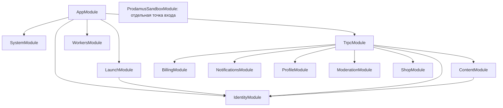

# Backend: карта модулей и открытый аудит — 3 ноября 2026

Снимок ДО новых изменений: b44e7998, чистая ветка
feature/stage-one-completion-2026-10-10. Ранее сделанные push/TEST-DI исправления
учтены как история, а не выданы за результат этой карты. Весь аудит **открыт**.

## Как читать статусы

- **Проверен**: изучены указанные границы и есть приведённое свидетельство;
  это не заявление о проверке каждого внутреннего сценария.
- **Найдены проблемы**: есть конкретный подтверждённый структурный дефект,
  указанный ниже; это не обязательно доказанная пользовательская уязвимость.
- **Требует исследования**: описана структура, но существенная часть поведения
  или интеграции ещё не проверена достаточно глубоко.

Карта покрывает все 13 классов Nest Module, все 16 директорий первого уровня,
10 корневых TS-файлов. Всего 241 исполняемый/обычный TS-файл и одна декларация
_core/types/cookie.d.ts. Из этого числа нельзя выводить процент приёмки.
Вложенные billing/yookassa и content/aesthetic-guides учтены в своих областях.
Фронт, рабочие БД/S3, сервер и настройки не меняются; без push/deploy.

## Граф Nest imports



У остальных Nest-модулей imports пуст. Это **не отсутствие зависимостей**:
обычные TS imports обходят Nest-контейнер и показаны отдельно ниже. Циклов
в данном графе Nest imports не обнаружено. Module exports изучены по исходникам;
новых Global/forwardRef зависимостей в карте нет.

## Все Nest-модули

| Модуль и владелец | Прямые Nest imports | Реальные обязанности/зависимости | Статус и точная граница проверки |
| --- | --- | --- | --- |
| AppModule — app.module.ts | System, Launch, Identity, Trpc, Workers | Сборка приложения; _core/application монтирует security/parsers/tRPC и legacy adapters | Проверен: фабрика, init/listen, ручной старт jobs, native/ESM tests; не живая публикация |
| TrpcModule — _core/trpc.module.ts | Content, Identity, Billing, Notifications, Profile, Moderation, Shop | TrpcService передаёт сервисы в routers.ts; auth/system/PenPals пока статические routers | Найдены проблемы: auth.logout использует собственный SessionService вместо внедрённого экземпляра |
| IdentityModule — identity/identity.module.ts | Нет | REST auth/password/binding; SessionService, guards/filter; db, platform-db, JWT, SMTP, SMS, admin actions | Найдены проблемы: разное владение REST и tRPC session dependency. SQL/HTTP auth проверялись; полный lifecycle binding и все отказы SMTP сейчас не перепроверены |
| ContentModule — content/content.module.ts | Identity | Чтение/запись постов, статей, комментариев, загрузки/защищённая выдача, VK; db/platform-db/media/push | Найдены проблемы: цикл импортов с db/club-access; 91 файл требует дальнейшего анализа транзакций/внешних эффектов, прошлые редакторские тесты не закрывают весь модуль |
| BillingModule — billing/billing.module.ts | Нет | Checkout/subscription/cancellation/settlement, LIVE/TEST Prodamus и YooKassa; db, identity, prodamus facade | Требует исследования: TEST-DI уже исправлен и 155 выбранных SQL/HTTP пройдены ранее; все LIVE/guest-normal/переходы провайдеров этим не проверены |
| ProdamusSandboxModule — billing/prodamus-sandbox.application.ts | Нет | Отдельная диагностическая app, только sandbox controller/service/security; без AppModule/db/workers | Проверен: узкая композиция и существующие runtime/ESM tests; это не платёжная приёмка |
| LaunchModule — launch/launch.module.ts | Identity | Capabilities, настройки оформления/получателя заказов; LaunchService → db/settings | Проверен: revisions/actor recheck/season calculation изучены, прошлые HTTP/SQL и native season cases; live settings не прочитаны заново |
| SystemModule — system/system.module.ts | Нет | REST /api/health, без БД и провайдеров | Проверен: это liveness, не readiness. Отдельный tRPC system.notifyOwner не принадлежит этому Nest-модулю |
| NotificationsModule — notifications/notifications.module.ts | Нет | Token/consent registration, SQL; router rate limiter/capability gate; push transport отдельно | Проверен: границы входа и предыдущие SQL/transport tests. Получение push устройством не подтверждено |
| ProfileModule — profile/profile.module.ts | Нет | Профиль/revision, recovery export, legacy avatar, удаление аккаунта; db/platform-db/content/media | Требует исследования: зафиксированы зависимости и прошлые profile tests; совместные отказы deletion/retention/files требуют отдельного прохода |
| ModerationModule — moderation/moderation.module.ts | Нет | Модерация пользователей/жалоб/комментариев через platform-db и content | Требует исследования: actor/target checks прослежены; полный конкурентный lifecycle модерации и удаления сейчас не выполнялся |
| ShopModule — shop/shop.module.ts | Нет | Старые digital checkout/owned endpoints, capability gate; db/prodamus; действующий магазин формирует mailto во фронте | Требует исследования: backend не доказывает отправку mailto-заказа; receipt/delivery legacy ветки и фактическое письмо менеджеру отдельно |
| WorkersModule — workers/workers.module.ts | Нет | Явный WORKER_OPERATIONS binding: publication, billing/email, retention/shop delivery, backups | Найдены проблемы: часть эффектов живёт вне Nest-сервисов; локальный single-flight не является распределённой координацией, уведомления публикаций без durable outbox |

## Фактическая карта областей TS

Стрелка означает прямую зависимость через импорт, а не HTTP-вызов. Здесь перечислены
backend-связи; Node/npm-пакеты и packages/shared/database идут следующим слоем.
Все директории из снимка учтены, включая области без собственного Nest Module.

| Область / число TS-файлов | Прямые соседние области | Статус |
| --- | --- | --- |
| _core / 29 | App, billing, content, db, identity, media, moderation, notifications, prodamus, profile, routers, shop, storage, workers, youtube | Найдены проблемы: pre-Nest session instances, global limiter/config и legacy notification adapter; необязательные helper-интеграции требуют исследования |
| admin / 5 | _core, billing, content, db, identity, media | Требует исследования: нет своего Nest Module; router собирает read/write/admin operations, полный анализ всех транзакций впереди |
| billing / 39 | _core, db, identity, prodamus, sms-auth | Требует исследования: legacy фасады + новые services, внепроцессная платёжная приёмка открыта |
| club / 1 | _core, billing, content, db, media | Проверен: router composition и middleware; это транспорт, не самостоятельный сервис |
| content / 91 | _core, db, identity, media, moderation, platform-db, push | Найдены проблемы: компонент импортного цикла; права и сохранение файлов не считать целиком проверенными |
| database / 1 | Только внешние mysql2/Drizzle | Требует исследования: mysql-utf8 tooling adapter, не основной runtime pool |
| identity / 22 | _core, admin, db, launch, platform-db, sms-auth | Найдены проблемы: session dependency ownership; sensitive lifecycle остаётся в очереди |
| launch / 5 | db, identity | Проверен в указанном выше объёме |
| media / 14 | _core, content, db, storage | Требует исследования: object policies/receipts/MIME/VK fetch; S3 и большие файлы сейчас не проверялись |
| moderation / 4 | _core, content, platform-db | Требует исследования |
| notifications / 5 | _core, db, launch, sms-auth | Проверен на транспортной/SQL границе, не доставка устройству |
| pen-pals / 2 | _core, db, launch, platform-db | Требует исследования: прошлые BOLA/lifecycle фиксы не заменяют новый полный проход; функция не включается |
| profile / 5 | _core, content, db, media, platform-db | Требует исследования |
| shop / 3 | _core, db, launch, prodamus | Требует исследования |
| system / 1 | Нет backend-зависимостей | Проверен как liveness |
| workers / 4 | _core, billing, db, identity, platform-db, prodamus, push, shop-delivery | Найдены проблемы/ограничения координации, см. приоритеты |

| Корневой TS-файл | Зависимости и ответственность | Статус |
| --- | --- | --- |
| app.module.ts | Корень Nest, граф выше | Проверен |
| routers.ts | _core/admin/billing/club/content/identity/moderation/notifications/PenPals/profile/shop; legacy appRouter + Nest factory | Найдены проблемы: auth router не принимает session dependency |
| db.ts | _core/admin/billing/content/prodamus; глобальный mysql pool + большой совместимый фасад | Найдены проблемы: цикл с domain helpers, владение pool не на уровне app |
| platform-db.ts | billing/content/db/identity/media/moderation/PenPals | Найдены проблемы: смешаны moderation, consent, retention, PenPals, shop mail, зависимость нескольких доменов |
| prodamus.ts | billing/db/identity/launch/shop-delivery | Требует исследования: контрактные функции, legacy fallback services и Express return adapters вместе |
| push.ts | db + внешний Expo | Проверен для acceptance/ошибок/deadline/cleanup; прошлый срез исправил четыре локальные проблемы, доставки нет |
| shop-delivery.ts | _core/launch/platform-db/push | Требует исследования: отдельный выключаемый digital delivery path, не mailto заказ менеджеру |
| storage.ts | _core/env + AWS SDK | Требует исследования: public/legacy S3 facade; роль и достижимость старых вызовов сверять до удаления |
| sms-auth.ts | _core/db | Требует исследования: отключённый SMS-путь + используемый clientIp helper, целиком удалять нельзя |
| youtube-stream.ts | _core/db | Требует исследования: legacy adapter, наличие файла не означает активный YouTube-каталог |

## Циклы и границы полноты

Локальный AST-анализ строился по TS после удаления type-only imports через
TypeScript transpileModule. Только литеральные static import/export/require
участвуют в поиске eager циклов; dynamic import учитывается отдельно для
достижимости. Это граф исходников до bundler tree shaking, а не доказательство
ошибки инициализации каждой записи. Проверка Nest/общих repo boundaries
не проверяет этот граф feature-зависимостей.

Найдена одна strongly connected component из 12 файлов:

```text
db.ts
identity/club-access.ts
content/article-writes.ts
content/post-attachments.ts
content/post-creator.ts
content/post-editor.ts
content/post-videos.ts
content/private-attachment-association.ts
content/private-attachment-uploads.ts
content/private-comment-actor.ts
content/private-content-binding.ts
content/private-content-uploads.ts
```

Пример пути: db → post-creator → post-attachments → private-attachment-association
→ private-attachment-uploads → db. Проверен по фактическим imports. Сейчас
инициализационный отказ не воспроизведён; риск — порядок загрузки и скрытая
связь SQL-фасада с записью/файлами. Не исправлять весь компонент одним переносом.

18 файлов не достигаются из трёх executable roots в этой модели. Среди них
миграционные/maintenance tools и compatibility context, используемый тестами;
не считать их мёртвым кодом. _core/dataApi, imageGeneration, llm,
voiceTranscription — кандидаты для дальнейшей проверки внешних потребителей,
не разрешение удалить публичные exports.

Локальные артефакты: ../.local-artifacts/backend-module-map-20261103/map.cjs,
map.json и summary.json. Они содержат пофайловые связи и metadata 13 modules,
без env/данных пользователей. Генератор ничего не импортирует на исполнение
и не подключается к БД/провайдерам. Декларация cookie.d.ts просмотрена отдельно.

## Выбор минимального изменения ДО правок

Выбран только **A2: владение SessionService для tRPC logout**, приоритет P2.
REST и tRPC context уже используют внедрённый SessionService, но authRouter
создаёт собственный экземпляр. Сегодня сервис в основном stateless, поэтому
не заявляем о доказанной потере отзыва сессий; подтверждена скрытая зависимость.

Минимальный план: createAuthRouter(session boundary), передать существующий
Nest provider через createAppRouter/TrpcService, сохранить standalone export
и прежний конструктор вызова. Не менять auth policy, SQL, JWT, cookie, DTO,
статусы и frontend. Сначала HTTP-тест двух apps: свой actor, успешный отзыв,
ошибка отзыва без стирания cookie; затем прежние SQL-сценарии logout/replay.

Отдельно выбранные ранее push/TEST-DI исправления уже завершены; повторно
переписывать их ради этой карты не требуется. Цикл/db/platform-db/лимитеры
остаются отдельными следующими задачами, а не частью скрытого большого рефакторинга.

## Оставшиеся архитектурные проблемы и приоритеты

| ID | Приоритет | Подтверждённое / неизвестное | Следующий ограниченный шаг |
| --- | --- | --- | --- |
| A1 | P2 | 12-файловый цикл db/content/club-access подтверждён. Ошибка загрузки не доказана | Отделить конкретный SQL reader/pool boundary без переноса всего db.ts; проверить ESM и транзакционный reader |
| A2 | P2, выбран | Ручной SessionService в authRouter подтверждён | Тест → factory injection → HTTP/SQL проверка; статус результата ниже |
| A3 | P2 | Общий pool/db facade и platform-db соединяют много доменов; multi-app lifetime не изолирован | Описать ownership/lifecycle, потом один узкий repository seam; не вводить generic repository |
| A4 | P2; P1 перед второй API-репликой | IntervalJobs координирует только один процесс, rate limiter тоже in-memory. Фактическая topology сейчас не прочитана | Подтвердить число реплик; до горизонтального масштабирования проверить durable claims/общую квоту. Вторую реплику автоматически не включать |
| A5 | P2, требует отдельного воспроизведения | _core/notification.ts выводит body/Error провайдера и не задаёт deadline. Внешний secret leak не проверен | Synthetic fault tests на активном admin endpoint; redaction/timeout при подтверждении, не дублировать большой HTTP framework |
| A6 | P2 | Request-body admission и compatibility context владеют отдельными SessionService; eager import router создаёт legacy services | Отдельно проверить pre-Nest ingress и CLI consumers до изменения composition |
| A7 | P2, условный риск | После публикации push не имеет durable outbox; что именно нужно гарантировать продукту — отдельно | Зафиксировать требуемую доставку. Не добавлять очередь как новую функцию без требования |
| A8 | P3 | Legacy/неиспользуемые helpers, размеры фасадов, форматирование | Проверить runtime/CLI/public consumers и удалять только доказанно неиспользуемое |

Новых подтверждённых P0/P1 дефектов поведения этим структурным проходом не
установлено. Это не означает их отсутствия. Billing LIVE/S3/SMTP/recovery/PenPals,
все транзакционные отказы, нагрузка и удалённая публикация требуют дальнейшей
проверки. Полнота карты не равна полноте аудита.

## Результат выбранного изменения

На момент составления карты runtime-изменения ещё не начинались. Результаты
RED/GREEN и выполненные команды будут добавлены отдельно после проверки.
