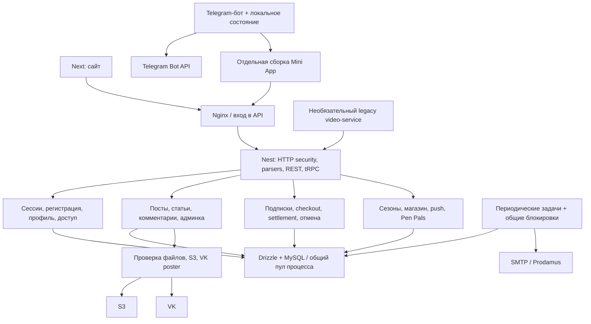

# Общее senior review Daryadarcy — 11 ноября 2026

## Локальные исправления после аудита

- **A2, backend исправлен:** точные публичные UUID/хеш-ключи проходят входную
  проверку и выдачу VK-каталога. Закрытые, подписанные и неоднозначные адреса
  отклоняются. Добавлены pure и HTTP/MySQL-проверки. Зеркальная проверка ручного
  ввода во фронте остаётся задачей из единого документа; компоненты не менялись.
- **A3 исправлен:** перед SMTP повторно проверяются lease, срок и состояние
  заявки/outbox. Три реальные SQL/loopback-SMTP регрессии подтверждают отказ старого
  процесса после истечения lease, обработки новым процессом и отмены заявки.
  Функция остаётся default-off; гарантии exactly-once внешнего SMTP не добавлены.
- **A4 исправлен:** positive production-build fixtures используют синтетический
  JWT-секрет; negative startup сохраняет отказ. Также исправлен устаревший stub
  отмены: теперь он проверяет передачу полного actor, а не только числового ID.
- **A5 исправлен в подготовке тестов:** общие таблицы магазина, push и Pen Pals
  создаются из фактических миграций, восстанавливается ON UPDATE старой тестовой
  DDL и поле consentText. Удалена дублирующая неверная DDL из retention-теста.
  Нагрузочные и overload-тесты явно выбирают свой профиль очереди.
- **A7 исправлен:** неправильное escape нового имени файла возвращает BAD_REQUEST
  400; транзакция не оставляет пост, receipt или уведомление. Исторические
  сохранённые вложения не переименовываются.

Целевые проверки: 46 unit и 123 SQL/HTTP прошли. Полный unit на Node 22:
**320 файлов / 4111 тестов прошли, 30 файлов / 98 тестов пропущены**.
Типы backend/frontend/e2e, lint, сборка API и проверка контракта прошли;
контракт сохранил 107 процедур / 46 862 байта. Полный SQL на Node 22 с обычным
окружением, без ручной подготовки таблиц и глобального burst-флага:
**112 файлов / 1776 тестов прошли, 23 файла / 365 тестов пропущены**.
Падений в обоих полных наборах нет. Реальные S3/browser/Docker gates не включались.
Логи до исправления и после него сохранены раздельно с префиксами `fix-red-*`,
`fix-green-*` и `fix-full-*` в прежнем локальном каталоге доказательств.
Независимая повторная проверка изменённых обработчиков, тестов и фикстур не нашла
новых обязательных замечаний. SMTP TOCTOU, frontend-нормализатор и старый offset
выделены как оставшиеся ограничения, а не закрытые этим прогоном пункты.

Открыты A1 (принятое ручное восстановление бота), A6 (совместимый переход с offset),
архитектурные и внешние пункты. Пуша, выкладки и изменений рабочих данных не было.
Ниже сохранены исходные выводы и результаты до исправлений.

## Вывод и границы

Исследованы действующий Next-фронтенд, Nest/tRPC API, модель данных и миграции,
фоновые задачи, Docker/Compose/CI, отдельный Telegram-бот и упаковка Mini App.
Найдены два новых функциональных дефекта: несовместимость адресов публичных обложек
и отправка письма привязки почты после потери lease. Также воспроизведено уже
документированное ограничение восстановления бота после аварии. Есть отдельные
проблемы воспроизводимости тестов. Это исследование;
первоначальный этап исследования не включал исправлений. Текущий статус вынесен выше.
Отдельно отмечена небольшая ошибка входной валидации URL видео.

Основа: `daryadarcy-app`, HEAD `a1608064`, ветка
`feature/stage-one-completion-2026-10-10`, с уже существующими локальными правками.
Обзор учитывает эти правки, а не только состояние HEAD. Отдельно прочитан соседний
проект `daryadarcy-telegram`. Компоненты, дизайн, рабочая БД, S3 и настройки бота
не менялись. Пуша и выкладки не было.

Инвентаризация нашла 257 файлов кода backend, 449 frontend, 23 shared, 10 video-service,
209 tooling и 52 SQL-миграции. Эти числа описывают размер исходников, а не обещание
построчной ручной проверки каждого файла. Для предметного обзора использованы
независимые проходы по клиенту, контентному API и платформе, затем проверка выводов
и воспроизведения. Критерий замечания: достижимое условие, конкретный эффект и
минимальное исправление. Необязательная косметика отделена от ошибок поведения.

Рабочий сервер Beget утрачен по сообщению владельца. Проверить состояние живого
окружения, его БД, старых ACL и настоящие внешние доставки этим обзором невозможно.
Зелёные локальные проверки не означают закрытия всего аудита или готовности выпуска.

## Карта компонентов и зависимостей

«Проверен» ниже означает просмотр названных сценариев и существующих проверок.
Он не означает исчерпывающую проверку всех входных комбинаций. Динамическое
покрытие и пропуски перечислены отдельно.

| Модуль / часть | Основные зависимости | Статус и фактический охват |
| --- | --- | --- |
| `app.module`, `_core/application`, HTTP/tRPC ingress | Identity, domain modules, Express | Проверены порядок parsers, ошибки, security, запуск и завершение |
| `identity`: сессии, регистрация, пароль | SDK/JWT, MySQL, письма | Проверены cookie, отзыв, блокировка, временный сбой, публичные ответы; прежняя ошибка размера JWT исправлена локально |
| `identity`: привязка почты | MySQL outbox, шифрование proof, SMTP | Найдена проблема lease перед отправкой, раздел A3; функция default-off |
| `identity/account-retention` | billing, users, контент, Pen Pals | Проверены очистка и повторная проверка условий; подозрение на удаление свежей анкеты оказалось расхождением тестовой DDL |
| `profile` | identity, users, публичные фото | Проверены revision, проекция ответа, текущая сессия, сохранение ввода |
| `billing`: checkout/guest/TEST | users, intent ledger, provider | Проверены принадлежность, повтор операции, потеря ответа, телефон; реальные LIVE-настройки требуют отдельной приёмки |
| `billing`: settlement, grants, access mail | users/payments/receipts/outbox | Проверены транзакции, свидетельства и повтор; внешняя доставка не имеет гарантии exactly-once |
| `billing`: cancellation/status | profiles, payments, worker, provider | Проверены pending/confirmed и повторы; прежний TEST/LIVE конфликт исправлен локально |
| `content`: посты и статьи | actor locks, revisions, creation receipts, DB | Проверены создание/правка/удаление, черновики, replay, конфликты и вложения |
| `content`: каталоги и детали | snapshot reads, DB, media binding | Проверены согласованность карточки/медиа, доступ и сортировка; старый offset-контракт остаётся ограничением A6 |
| `content`: комментарии, ответы, реакции | post visibility, actor, DB | Проверены ownership, сроки, родительские связи, keyed-create; массовые toggle зависят от принятого лимита пула |
| `content`: сохранённое | session scope, visibility, cursors | Проверены открытые/клубные записи, принадлежность и pagination |
| `content`: VK | provider client, thumbnail policies | Найден несовместимый public-cover namespace, A2 |
| `admin` | domain writers, revisions, operation receipts | Проверены права, адресный readback, продление, email, участники; часть функций реализована сервисами других доменов |
| `media`, `storage`, приватные загрузки/выдача | S3, DB receipts, session/access | Проверены точные namespace, bindings, retirement, Range/ETag, no-store, abort; настоящие S3 ACL и 32/80 МБ здесь не проверялись |
| `moderation` | comments/reports, staff | Проверены удаление, жалобы, права и клиентское восстановление неизвестного результата |
| `pen-pals` | users, profiles, matches, consent | Проверены decline ownership, active profiles, deadline, mutual-only адреса; старый BOLA закрыт; live feature не включалась |
| `launch` / сезоны / capabilities | launch settings, clock, flags | Проверены ревизии и соглашение флагов с клиентом; состояние нового сервера неизвестно |
| `shop`, `shop-delivery` | каталог, контакты, optional payments/SMTP | Рабочий mailto явно требует ручной отправки. Online-payment ветка отдельно выключена; получение настоящего заказа не доказано |
| `notifications`, `push` | capability gate, validation, rate limit | Проверены запрет записи при выключении, формат и ограничения; доставка push остаётся best effort по решению владельца |
| `workers` | DB coordination, billing, retention, backup | Проверены lifecycle, интервалы, остановка и fence; отдельный пробел в binding mail A3 |
| `_core/backup` | mysqldump, gzip, filesystem, S3 | Проверены текущие lifecycle/cleanup helpers; upload целиком читает архив в память, архитектурный риск B3 |
| `database`, `db.ts` | mysql2, Drizzle, named locks | Проверены конечная очередь, общая координация и shutdown; для нового хоста остаётся приёмка нескольких API |
| `packages/database` | schema, journal, migrations | 52 SQL и 52 записи журнала; проверены preflight/fresh-профиль и тестовая схема; результат живого применения ниже |
| `packages/shared` | backend/frontend adapters | Проверены общие контракты, URL/VK parsing и projection по используемым цепочкам |
| Frontend: session/query/storage | REST/tRPC, React Query, IndexedDB | Проверены отмена, смена аккаунта, очистка личного кэша и сохранение сессии при временной ошибке |
| Frontend: редакторы | operations, upload receipts, revisions | Проверены journal/checkpoints, сохранение ввода и recovery по исходникам; настоящие браузерные гонки здесь не повторялись |
| Frontend: checkout/subscription | billing API, durable journals | Проверены раздельные TEST/NORMAL/guest, readback и pending cancellation |
| Frontend: Feed/Club/Saved | query scopes, post APIs, media | Проверены дедупликация, доступ, лайки/сохранения, комментарии; offset ограничивает полноту при параллельной публикации |
| Frontend: Video/Library | protected reads, media lifecycle | Проверены retries/release/playback, бесплатная «Лошадка», закрытые PDF без public fallback; frontend allowlist тоже затронут A2 |
| Frontend: Home/Quiz/Legal/Shop | shared settings, local quiz state | Проверены навигация, reducer, Web Locks/account isolation, ссылки; юридический текст требует сверки владельцем |
| Frontend: PWA | manifest, install UI, HTTP cache | Частично проверен. Service worker в текущих frontend sources не найден; нельзя приписывать ему работу HTTP-кэша |
| Telegram-бот | Bot API, durable offset, локальная очередь | 78 штатных тестов прошли; аварийное восстановление сломано, A1 |
| Отдельная Mini App | копия frontend, proxy main API, старый base image | Упаковка просмотрена; переносимость и соответствие актуальному сайту требуют дополнительной проверки |
| `apps/video-service` / `youtube-stream` | yt-dlp, FFmpeg, публикации API | Просмотрены cache/upstream/prepare, 46 тестов прошли; VK от этой legacy-ветки не зависит |
| Docker/Compose/Nginx | API, Next, MySQL, overlays | Просмотрены основной и multi-API профили, ресурсы/сети, feature overlays; итоговый образ и новый хост в этом проходе не запускались |
| GitLab CI | runner, MySQL service, Playwright | SQL изолирован по проекту и файлам; найдены несовместимые fixtures, A4–A5. Реальный runner не подтверждён |
| `tooling`, legacy apps/helpers | прежние PM2/SSH/layout, старые платформы | Проверены активные границы и документация. Полный ручной обзор всех legacy tools не выполнен; это не действующий путь выпуска |

## Подтверждённые замечания

### A1. P2, известное ограничение: restart-policy не поднимает бот после аварии

В соседнем `daryadarcy-telegram/src/state.js:14` создаётся постоянный файл
`.lock` через `openSync('wx')`. Удаление находится только в штатном `close()`
на строках 41–45. В `scripts/server-release.py:105` бот запускается с
`--restart unless-stopped`, а `.state` хранится на bind mount.

Воспроизведение без токенов: дочерний процесс открыл состояние, сохранил offset,
получил SIGKILL. Новый процесс отказался с `Bot lock exists`. Так же ведут себя
OOM/перезапуск хоста. Данные offset сохраняются, но работа бота не возобновляется.
Прерывание между созданием `.json.tmp` и rename дополнительно оставляет файл,
который мешает следующему `claim()` даже после ручного снятия `.lock`.

В README бота на строках 109–111 это уже описано как ручная процедура без
автоочистки. Следовательно, это подтверждённое эксплуатационное ограничение,
а не новая регрессия. Если ручное восстановление принято, нужен актуальный
runbook для нового хоста; если требуется автоматический restart, нужен шаг ниже.

Минимальное решение: блокировка с освобождением при смерти владельца либо надёжное
восстановление владения и своей незавершённой временной записи. Слепое удаление по
PID в контейнере ненадёжно. Сохранить запрет двух одновременно работающих ботов
и принятую семантику offset. Добавить два crash-теста.

### A2. P2: результат штатной загрузки обложки не принимается VK-каталогом

`media/public-photo-object.ts:15` создаёт `covers/public-v1/<uuid>.webp`.
Это штатный результат `admin.uploadPublicCover`. Однако
`content/video-thumbnail.ts:18` разрешает только S3 `feed/` и `app-assets/`.
`content/vk-video-input.ts:74` отклоняет такую новую обложку, а
`content/vk-catalog.ts:186` превращает уже сохранённую в `null`.

Чистые вызовы подтвердили отказ для `covers/public-v1/UUID.webp` и
`covers/vk-v1/HASH/HASH.webp`; контрольные `feed/cover.webp` и
`app-assets/videos/cover.webp` проходят. `content/private-v1` отклоняется.
S3 не использовался. Этот дефект доказывает несогласованность контрактов,
но не устанавливает причину каждой прежней неработавшей обложки на стенде.

Минимальное решение: допускать точные формы действительно публичных серверных
ключей, с negative tests для private, encoded traversal, query и чужих origin.
Во frontend `features/videos/catalog-api.ts:38` находится зеркальная политика;
её нужно согласовать с backend после уточнения контракта. Разрешать весь бакет нельзя.

### A3. P2 перед включением привязки почты: старый worker может повторно отправить письмо

В `identity/email-binding-delivery.ts:138–146` lease выдаётся на пять минут.
После commit до `send()` на строке 160 принадлежность lease больше не проверяется.
Проверка при финальной записи защищает БД, но уже отправленное письмо не отменяет.

В настоящей одноразовой MySQL процесс A остановлен после фиксации claim.
Его lease сделан истёкшим только в собственной фикстуре. Процесс B забрал работу,
успешно вызвал локальный callback и записал sentAt. После продолжения A тот же
callback был вызван ещё раз: `replacement-worker`, затем `old-worker`.
В БД `attempts=2`, `sent=1`, cipher очищен. Реальные письма не отправлялись.

Функция default-off: `MEMBER_EMAIL_BINDING_ENABLED`. Это не утверждение об уже
случившейся рассылке. Минимальное исправление: финальная проверка текущего lease,
срока, pending/sent/discarded перед внешней отправкой, по принятому образцу access
mail/cancellation. Остаточное окно между последним чтением и SMTP остаётся
ограничением внешней доставки; проверка не создаёт гарантии exactly-once.

### A4. P2: три production-build теста больше не запускают своё приложение

`tests/billing-checkout-built.test.ts:130`,
`tests/prodamus-sandbox-built.test.ts:46` и
`tests/prodamus-test-built.test.ts:30` формируют изолированное окружение
`NODE_ENV=production` без подходящего `JWT_SECRET`.
`_core/session-config.ts` правильно запрещает такой запуск.

Все три проверки упали в общем прогоне и повторно на поддерживаемом Node 22.
Две показывают ошибку минимальной длины JWT-секрета, третья завершается до readiness
в том же composition root. Эти падения блокируют зелёный CI; это не основание
ослаблять production validation.

Минимальное решение: добавить явный синтетический JWT-секрет в positive startup
фикстуры; negative startup оставить без действующей конфигурации. Секреты настоящего
окружения в тесты не передавать.

### A5. P2: тестовая схема и ожидания нагрузки расходятся со штатным запуском

Первый полный SQL-прогон дал восемь падений в трёх файлах:

- `shop-checkout-actor.mysql.test.ts` не создаёт `shop_purchases`; общий helper
  её тоже не создаёт. Три теста падают в cleanup ещё до предметной проверки.
- `account-retention.mysql.test.ts:32` создаёт `pen_pal_profiles.updatedAt` без
  `ON UPDATE CURRENT_TIMESTAMP`. Последующий `pen-pal-maintenance` считает недавно
  заполненную и отозванную анкету старой. Штатная миграция `0008_pen_pals.sql`
  содержит `ON UPDATE`, поэтому это не подтверждённая потеря данных приложения.
- Четыре проверки `nest-comments.mysql.test.ts:732` требуют успеха всех 21/28
  одновременных toggle, а default-пул допускает 10 соединений и очередь 10.
  Часть запросов корректно получает 503. Профиль очереди 40 включается отдельно
  через `API_DB_BURST_QUEUE_ENABLED=true`.

Контроль: только в одноразовой БД создана штатная таблица магазина, исправлена
DDL даты, выбран burst-профиль. Все 53 теста этих трёх файлов прошли на Node 22.
Исходники не менялись. Минимальное решение: единая миграционно-верная схема fixture,
явные профили обычной и burst-нагрузки и отдельные ожидания для overload. Нельзя
скрывать исходные падения повторным прогоном без описания отличий.

Обратное расхождение обнаружено в `api-pool-pressure.mysql.test.ts`: helper
занимает 10 соединений и ровно 10 мест очереди, затем ожидает немедленного 503.
При включённой очереди 40 запросы ещё помещаются в неё и достигают клиентского
таймаута. Этот файл должен явно выбирать обычный профиль, а concurrency-тесты —
свой burst-профиль; один глобальный флаг не делает весь набор согласованным.
При отдельном повторе после abort-набора обнаружена оставшаяся синтетическая
запись `pressure-created`: один assert упал. После её штатной очистки все шесть
проверок обычного профиля прошли. Это дополнительный повод дожидаться завершения
собственных HTTP-обработчиков перед teardown; источник остаточной записи в этом
проходе отдельно по времени commit не трассировался.

### A6. P2, ранее известное: числовой offset не гарантирует полный просмотр меняющейся ленты

`content/post-catalog-repository.ts:131–154` по-прежнему преобразует `cursor` в
SQL offset; аналогично устроены старые клубные списки. Короткая snapshot-транзакция
защищает один ответ, но не несколько запросов между публикациями/удалениями.
Новая запись перед первой страницей даёт повтор, удалённая запись даёт пропуск.
Клиентская дедупликация не восстанавливает пропущенное.

Подробное прежнее HTTP-воспроизведение находится в
[обзоре чтения постов](backend-post-read-concurrency-2026-11-09.md).
Текущий исходник подтверждает сохранение контракта; заново ошибка не объявляется
новой. Следующий отдельный контракт — непрозрачный курсор порядка публикации
с согласованием поведения при изменении сортировочных полей и прав.

### A7. P3: неверное escape в URL видео даёт 500 вместо 400

Новый `%ZZ.mp4` проходит строковую входную схему, а
`content/post-videos.ts:71` вызывает неперехваченный `decodeURIComponent`.
Существующий SQL-тест `post-creation-idempotency.mysql.test.ts` подтверждает rollback,
но проверяет только reject, а не BAD_REQUEST. Ошибка не портит частично записанный
пост. Нужна проверка входа до мутации и регрессия на код 400.

## Проверки и доказательства

| Проверка | Результат этой итерации |
| --- | --- |
| Весь `unit`, Node 23.10.0 Mac | 316 файлов прошли, 3 упали, 30 пропущены; 4090 тестов прошли, 3 упали, 98 пропущены |
| Весь `unit`, повтор на Node 22 | Те же 316 файлов / 4090 тестов прошли; те же 3 startup падения, 30 файлов / 98 тестов пропущены |
| Три упавших compiled-startup теста, Node 22 | Повторно все три упали; причина A4 сохраняется |
| Весь `mysql`, отдельная MySQL 8.4 в tmpfs | 109 файлов прошли, 3 упали, 23 пропущены; 1762 теста прошли, 8 упали, 365 пропущены |
| Разбор трёх упавших SQL-файлов, Node 22 | 3 файла, 53 теста прошли после описанной в A5 настройки только фикстуры |
| 52 миграции на пустой отдельной MySQL | `fresh-install-local`: initialized=true, pending=[]; создан только одноразовый профиль |
| Весь `mysql`, свежая миграционная схема, Node 22, очередь 40 | 111 файлов прошли, 1 упал, 23 пропущены; 1765 тестов прошли, 5 упали, 365 пропущены. Все 5 — overload expectations файла `api-pool-pressure`, A5 |
| `api-pool-pressure`, Node 22, обычная очередь, чистая фикстура | 6 тестов прошли. Первый повтор с остаточной синтетической записью: 5 прошли / 1 упал; он также сохранён в логах |
| Binding lease | Настоящий SQL, две локальные отправки одного proof после истечения lease; A3 воспроизведён |
| VK cover namespace | Чистые вызовы валидатора и projection подтвердили A2 |
| Telegram bot | 78 штатных тестов прошли; crash recovery отдельно воспроизведён |
| Optional video-service | 46 тестов прошли |
| `pnpm check` | Backend/shared и frontend/e2e типы прошли |
| `pnpm check:api` | Прошёл: 107 процедур, 46 862 байта; ручных frontend casts для нового API не добавлялось |
| `pnpm check:boundaries` | Прошёл: 912 файлов |
| `pnpm lint` | Backend и frontend прошли |
| `pnpm build` | Backend bundle собран; это не production-сборка Next и не Docker image acceptance |
| `pnpm check:docs` | После добавления отчёта прошёл: 193 актуальных документа |
| Production dependencies | `pnpm audit --prod`, также из frontend: один low, 0 moderate/high/critical |

Широкий первый запуск использовал имеющийся Node 23, тогда как CI/Docker используют
Node 22. Затем полностью повторены unit и SQL на Node 22; результаты исходного
и контрольного профилей сохранены раздельно. Полный браузерный Playwright, новая сборка
Next/Docker и многопроцессная нагрузка в этом проходе не выполнялись. На диске Mac
меньше 1 ГБ, поэтому тяжёлый билд без места не запускался.

Пропуски включают отдельные gates для реального S3, Linux/Docker acceptance,
browser fixtures и fresh-database сценариев. Ни один пропущенный сценарий не
засчитан как passed. Воспроизведения, начальный SQL-лог, контрольные логи и
dependency JSON сохранены вне Git в соседнем каталоге
`.local-artifacts/project-senior-review-20261111/`.
Оба созданных для аудита MySQL-контейнера после проверок удалены вместе с их
одноразовыми tmpfs; другие контейнеры, образы и volumes не удалялись.

## Зависимости

Для `fast-xml-parser 5.7.3` через AWS SDK найден
[GHSA-474x-hrwr-fgx4](https://github.com/advisories/GHSA-474x-hrwr-fgx4): low,
исправление начиная с 5.12.0. Согласно advisory требуется нестандартный `stopNodes`.
Просмотренный AWS XML-parser этот режим не включает. Эксплуатация в текущем S3-пути
не подтверждена. Нужен отдельный небольшой update с проверкой SDK, а не произвольная
замена lockfile или заявление об открытой уязвимости загрузок.

## Оставшиеся архитектурные вопросы

В предыдущей итерации уже исправлены два отдельных дефекта: разовая TEST-оплата
больше не мешает отмене следующей LIVE-подписки, а размер сессионной cookie больше
не зависит от полного имени. Их причины, первоначальные воспроизведения и
проверки исправлений находятся в [предыдущем отчёте](backend-code-review-2026-11-11.md).
В первоначальной итерации менялись только документы. После неё локально исправлены
A2–A5 и A7, как указано в начале отчёта; внешняя и архитектурная приёмка остаётся открытой.

| Приоритет | Что остаётся | Условие закрытия |
| --- | --- | --- |
| P1 перед публичным выпуском | Восстановление инфраструктуры и пользовательских данных после Beget | Новый хост, восстановленная проверенная копия, сверка данных после даты дампа, ключи и runtime settings; отдельно backup/restore |
| P1 перед включением LIVE | Реальные Prodamus и письма после подтверждённой оплаты | Кабинет владельца, боевой тариф/секреты/подписка, приёмка success/retry/отмена и фактического получения письма |
| P2 перед несколькими API | Общий пул HTTP/worker, очередь, блокировки и ресурсы | Реальный целевой Linux, принятый профиль, две реплики под нагрузкой и restart; лимиты нельзя выводить только из Mac |
| P2 | Mini App — копия frontend и deployment под прежний хост | Переносимый воспроизводимый пакет, общая версия ассетов/контрактов, проверка Telegram/iPhone PDF и возвратов медиа |
| P2 | Связность `db.ts`, compatibility/internal writers без actor | Инвентаризация оставшихся callers и постепенное сужение экспортов с сохранением фасадов до миграции; массовое переписывание не требуется |
| P2 | SMTP/провайдер могут принять действие перед потерей ответа | Описанная модель at-least-once/unknown, статусы и квитанции; нельзя обещать exactly-once только за счёт SQL lease |
| P2 | Backup upload читает gzip целиком (`_core/backup.ts:169`) | Потоковое чтение с ограничением памяти и тестом отказа/abort либо документированный безопасный размер архива |
| P2 | Тесты моделируют схему вручную и зависят от порядка | Общая миграционно-верная инициализация и независимые fixtures; настоящий runner с чистой БД |
| P2 | Несколько копий политик медиа URL | Единый тестируемый контракт допустимых публичных путей при раздельной проверке на каждой границе |
| P3 | Исторические PM2/Windows/S3 helpers всё ещё доступны командами | Явное ограждение legacy entrypoints; `deploy:api` не считать новым рабочим путём; исходники и бэкапы не удалять автоматически |
| P3 | Невидимый slideshow на Home | `home-screen.tsx` меняет два слоя с одним `heroImage`; можно убрать лишний таймер без дизайна |
| Согласование содержимого | Legal упоминает SMS/Pen Pals и старую online-оплату магазина | Владелец подтверждает актуальные формулировки; правовая оценка в это code review не входит |

## Минимальная следующая работа

1. Для A1 подготовить проверяемое ручное восстановление либо отдельно принять автоматический вариант с crash-тестами, сохранением offset и запретом двух процессов.
2. Применить у фронтендера зеркальный public-cover контракт A2; backend локально готов.
3. A3 проверен локально; оставить привязку почты выключенной до отдельной приёмки функции.
4. A4–A5 исправлены локально; подтвердить чистый прогон на подключённом runner.
5. A7 исправлен локально. A6 делать отдельным совместимым переходом API.

Для фронтендера сейчас есть одна подтверждённая совместная правка A2. Массовая
замена компонентов, редизайн, отказ от текущих recovery journals и расширение
scope аудита новыми функциями не нужны. Настоящие браузерные сценарии, устройства,
внешние оплаты/почта/S3 и приёмка восстановленного хоста остаются открытыми.
