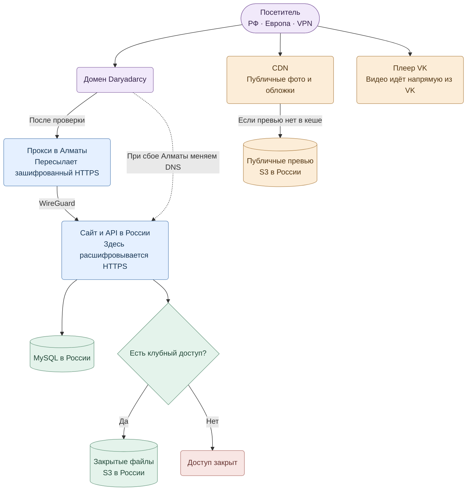
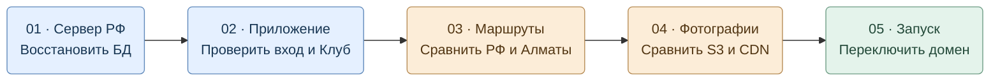

# Маршрут Daryadarcy

> Это целевая схема, а не уже развёрнутая сеть. Сначала восстановить российский backend/БД из доступных проверенных копий, затем измерить маршруты и CDN. Расположение фактических данных и стабильность с конкретными VPN здесь не подтверждены.

## Как идут запросы

## Порядок запуска

[Подробный порядок настройки для DevOps](server-migration-ru-kz-cdn-2026-11-10.md)
